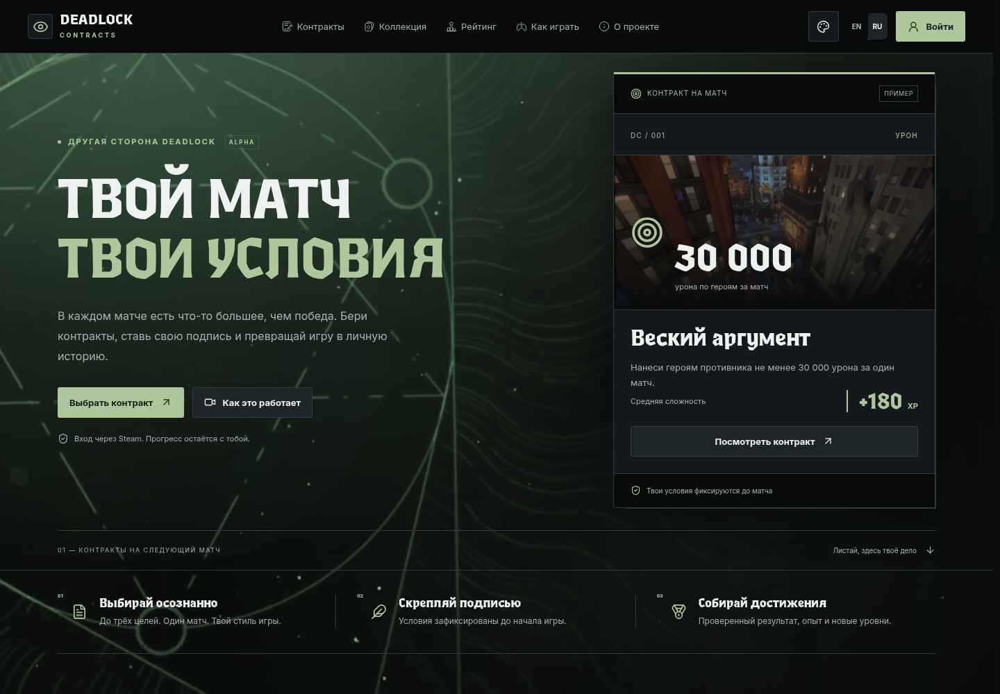

# Deadlock Contracts

Я делаю дополнительную систему прогресса для Deadlock: игрок выбирает задания перед матчем, играет, а после проверки результата получает опыт и повышает уровень. Хотелось дать обычным матчам небольшую цель, которую выбираешь сам.

[Сайт](https://deadlock-contracts.online) · [Поддержка](https://t.me/deadlockts_bot) · [Документация](PROJECT.md)

## Что уже работает

- Вход через Steam и отдельные доски для Standard, Ranked и Street Brawl.
- Выбор от одного до трёх заданий, подписание контракта, попытки и автоматическая проверка матча.
- XP, уровни, история дел, достижения и личная статистика.
- Companion на Overwolf: привязка к аккаунту, игровой оверлей и предварительный прогресс во время матча.
- Коллекция карточек, избранное, витрина и один бесплатный пак в день.
- Бюро игроков, совместные операции, публичные профили и рейтинг с настройками приватности.
- Админка с ролями, очередью проверки, журналом действий и системными объявлениями.
- Русский и английский языки, пять режимов оформления и настройка анимаций.

Проект находится в альфе. Доступность проверки зависит от данных матча и включённых серверных возможностей. Неполные данные не считаются автоматическим провалом задания.

## Как устроен проект

| Часть | Стек и назначение |
| --- | --- |
| Backend | Python, FastAPI, SQLAlchemy, PostgreSQL, Alembic |
| Фоновые задачи | Отдельный Python worker, очередь и журнал событий в PostgreSQL |
| Frontend | React 19, TypeScript, Vite, Tailwind CSS и обычный CSS |
| Companion | JavaScript, HTML/CSS, Overwolf API и Game Events Provider |
| Инфраструктура | Docker Compose, Caddy, Redis для общего ограничения запросов |
| Проверки | pytest, Node.js test runner, TypeScript, проверки миграций и GitHub Actions |

Результат задания и награду определяет сервер. Сайт и Companion показывают состояние и передают данные, но не могут самостоятельно начислить XP. Повторный запрос или перезапуск приложения не должен выдавать награду ещё раз.

У проверки два пути: обычное получение итогов через Deadlock API и отдельно включаемая серверная обработка данных Companion. Второй путь ограничен флагами и списком разрешённых аккаунтов. Подробности — в [описании проверки матчей](PROJECT.md#match-verification).

## Запуск локально

Нужны Git, Docker и Docker Compose:

~~~bash
git clone https://github.com/SaitWors/Deadlock-Contracts.git
cd Deadlock-Contracts
docker compose up -d --build
~~~

Репозиторий пока приватный, поэтому для клонирования нужен доступ.

Сайт: [localhost:8080/ru/](http://localhost:8080/ru/). Локальная тестовая сессия: [localhost:8080/dev/preview](http://localhost:8080/dev/preview).

В локальном Compose по умолчанию используется mock-провайдер. Этого хватает, чтобы посмотреть интерфейс и проверить сценарии разработки. Для настоящих матчей нужны Steam, настройка источника данных и Companion. Инструкции по разработке, production и сборке OPK собраны в [PROJECT.md](PROJECT.md).

## Что здесь интересно с точки зрения разработки

Основная сложность оказалась в согласовании данных. Match ID может появиться поздно, итог матча — ещё позже, пользователь может закрыть игру или потерять сеть. Поэтому я разделил предварительный прогресс и окончательный результат, добавил восстановление очереди, привязку к игровой сессии, повторные попытки и защиту выдачи наград от дублей.

В интерфейсе тоже есть привязка к серверному результату: сцена завершения воспроизводит сохранённые задания, XP и переходы уровней. Повтор анимации ничего не начисляет.

Арена, шифр и монеты были отдельным экспериментом. Позже я убрал их из действующего пользовательского сценария, чтобы основными остались контракты и личный прогресс. Старые данные и миграции сохранены.

## Документация

В [PROJECT.md](PROJECT.md) собраны устройство frontend и backend, Companion, API, база данных, модель доверия, запуск, обновление, восстановление, проверки, сторонние материалы и история разработки.

Версии сайта и Companion задаются в [release.json](release.json) и [companion/release.json](companion/release.json).

Автор: [Даниил Рестеу / SaitWors](https://github.com/SaitWors), Mandarin Creator Group.

Deadlock Contracts — неофициальный проект сообщества. Deadlock, Steam и связанные материалы принадлежат их правообладателям; связи с Valve Corporation у проекта нет.
