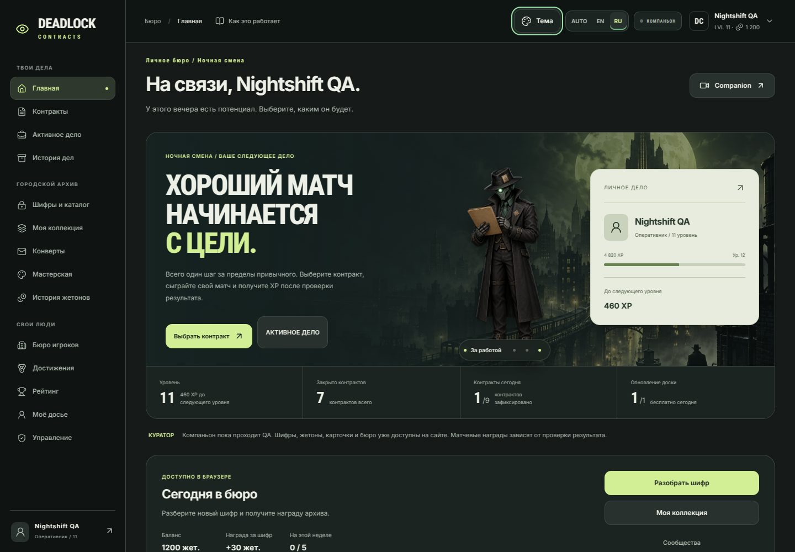
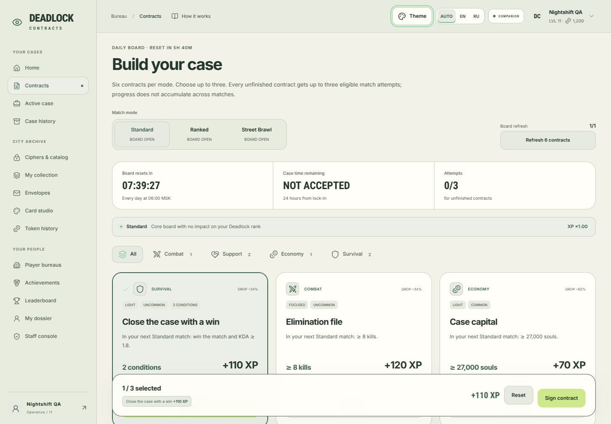
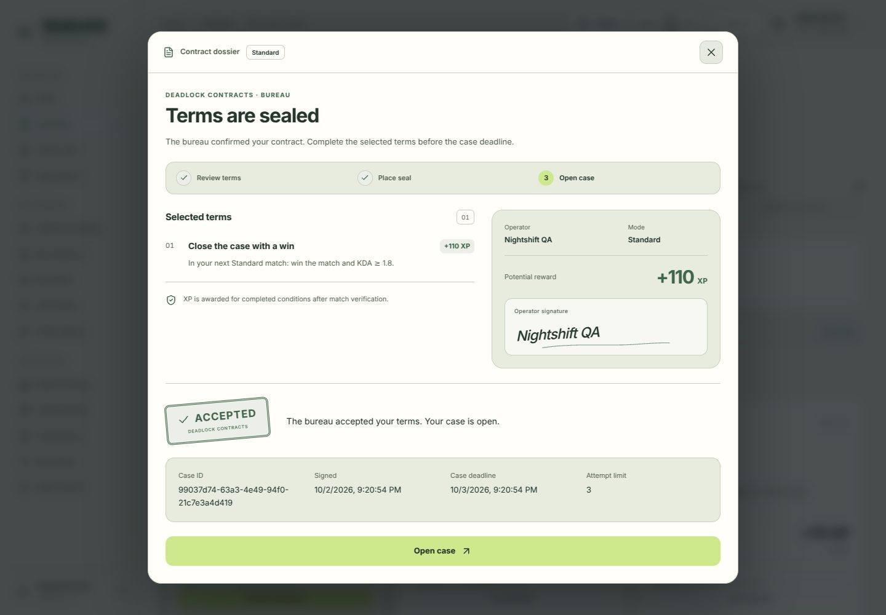
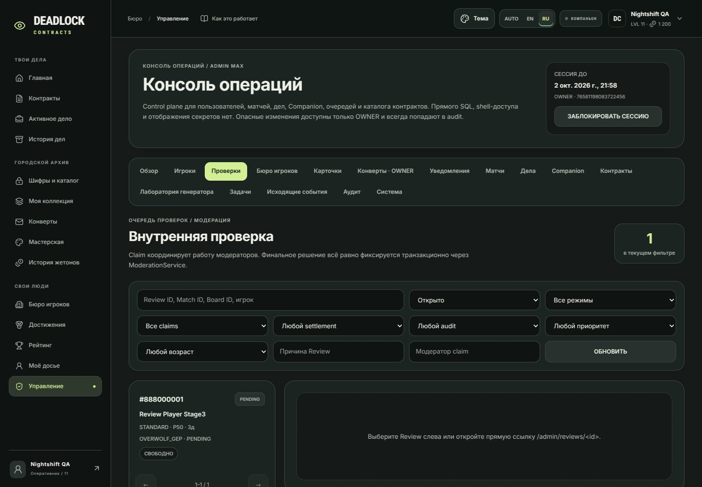
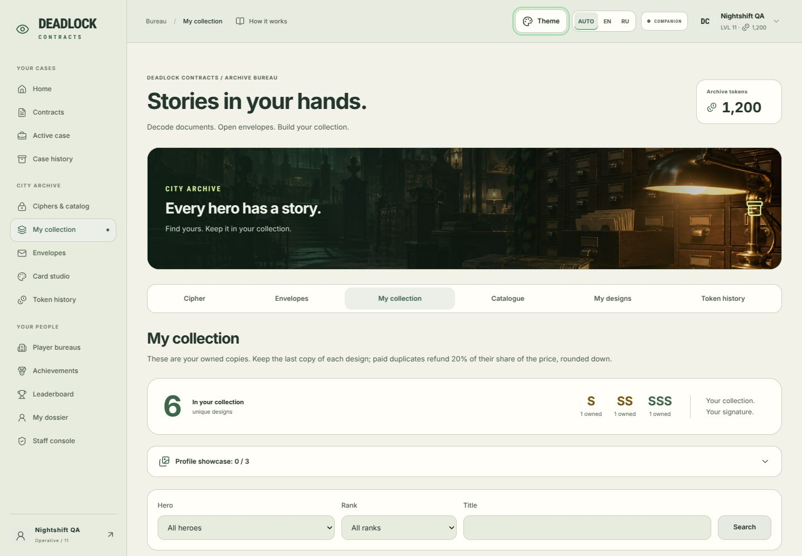
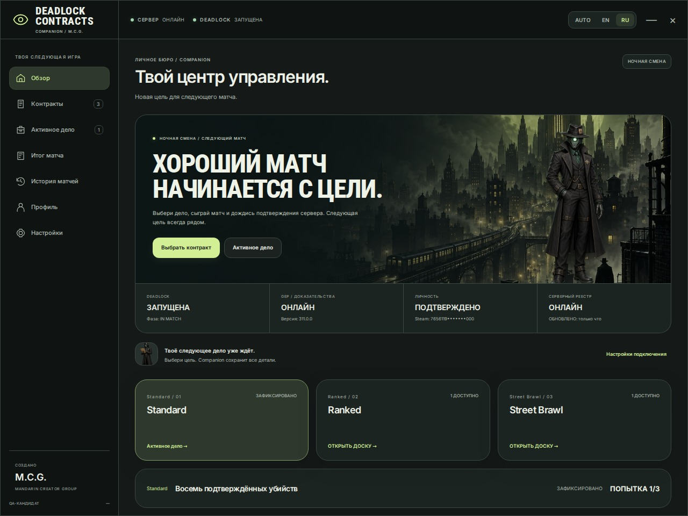
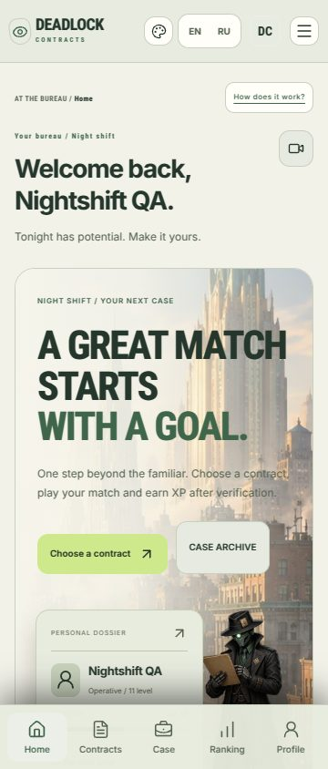

# Nightshift: complete interface refresh

The first Nightshift update left feature screens using the previous design. This change applies the approved rounded panels, typography, navigation, controls and theme colors throughout the working application, including the desktop Companion and overlay.

## Scope

- Public landing, demo contract selection, signing preview, documents and help.
- Signed-in home, contracts, active cases, history, personal dossier, account settings and Companion pairing.
- Archive, cipher, envelopes, collection, card preview, card studio and token history.
- Player bureaus, bureau editing, achievements and leaderboard. Existing player artwork and customization remain visible.
- All 16 staff sections: overview, players, reviews, bureau reports, cards, packs, announcements, matches, cases, Companion, contracts, generator lab, jobs, outbox, audit and system.
- Contract signing now presents terms, an optional signature, confirmation progress and a receipt. The accepted stamp only appears after the server confirms a real contract. Retry and stale-selection handling are preserved.
- Companion desktop views and in-game overlay share the website's visual language, three mascot poses, five theme choices and reduced-motion preference. Overlay language now follows the saved desktop preference.

Existing authentication, permissions, TOTP, CSRF, backend APIs, verification and Companion evidence processing are unchanged. No demonstration data is included in production code. Obsolete CSS was removed without increasing asset budgets.

## Preview

Screenshots use an isolated local database populated for design review.

## Verification — 2026-10-02

| Check | Result |
| --- | --- |
| Frontend formatting, TypeScript and production build | Passed |
| Frontend tests | 123 passed |
| Backend pytest | 414 passed; 1,188 subtests passed |
| Companion functional tests | 119 passed |
| Companion contrast | 204 text/background pairs passed |
| Companion OPK and QA bundle | Built and verified; packaging tests 2 passed |
| Bureau design exports | 30 reward IDs and 60 licensed icons exported |
| Initial / total JavaScript | 299,958 / 677,655 bytes, within existing limits |
| Total CSS / all assets | 431,522 / 2,983,827 bytes, within existing limits |

Chromium verification covered all 14 workspace destinations, all 16 loaded admin sections, desktop and 360/768 px layouts, five themes, guest and signed-in states, and persisted RU/EN changes. It completed a real local login, TOTP elevation, signing cancellation, server-confirmed signing and navigation to the active case. There were no page errors, HTTP errors, broken images or document-level horizontal overflows in those journeys.

Populated feature fixtures additionally covered admin review details, player details, announcement editing, bureau customization, archive interactions and Companion desktop/overlay states. The signing tests include delayed confirmation, retries, stale selections, keyboard handling and visible focus restoration on desktop and mobile.

The local sandbox required an unrestricted local process for browser and backend tests. Companion packaging tests used file-based subprocess output capture because pipe capture was denied; test commands, exit statuses and assertions were unchanged. GitHub CI also runs the normal test and packaging commands.

Real Steam authentication and a live Windows Overwolf/Deadlock session were not exercised locally. Deployment and merge are separate from this change.
