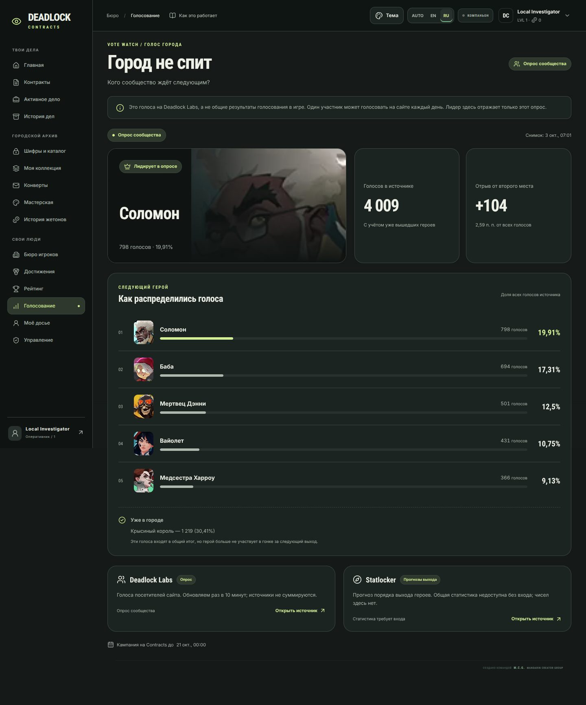
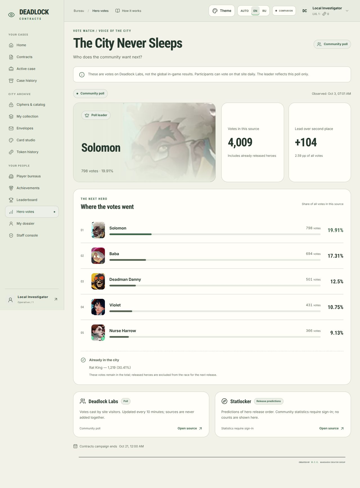
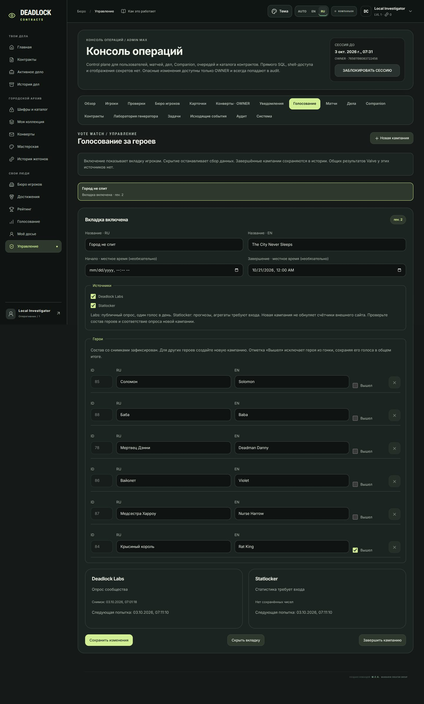
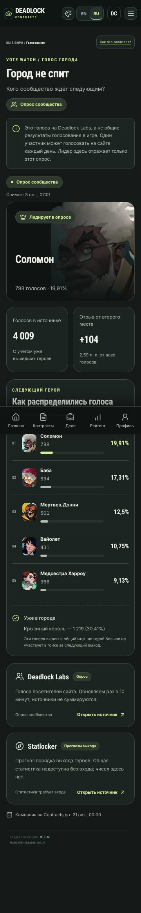

# PR44.5 — Hero vote watch

The Nightshift dashboard has a conditional **Голосование / Hero votes** tab at `/#hero-votes`. It shows counts, percentages, the leader among unreleased heroes, the lead over second place, observation time, and changes since the previous successful observation. Ties, empty polls, first fetches, outages and stale observations have separate states. Both Russian and English use the existing appearance variables and reduced-motion setting.

## What the numbers mean

| Source | Read-only endpoint | Scope / availability verified on 2026-10-03 |
| --- | --- | --- |
| [Deadlock Labs](https://deadlocklabs.gg/updates/city-never-sleeps/) | `GET https://deadlocklabs.gg/api/backend/v1/hero-votes` | Public JSON `counts` keyed by Steam hero ID. Votes cast on the Labs website, once per participant per day. **Not Valve’s global in-game totals or unique voters.** |
| [Statlocker](https://statlocker.gg/cns-sweep/predict) | `GET https://statlocker.gg/api/cns-predict/community` | Release-order predictions; community aggregates return **401 without authentication**. Shown as a separate source link with “statistics require sign-in”, never as a vote tally. |

The live browser verification observed 4,009 Labs votes. Screenshot numbers are an observation, not bundled demo counters. All production numbers come from persisted provider responses. The screenshot’s timestamp is displayed in the browser’s local timezone (Europe/Moscow in this verification).

Rat King is initially marked released, so Solomon can lead the remaining race even when Rat King has more votes. Percentages and the lead in **percentage points** use the entire source total, including released heroes. Sources are never added together. Changing a campaign does not reset a third-party poll.

Hero ID mapping for the preset: `85` Solomon, `88` Baba, `78` Deadman Danny, `86` Violet, `87` Nurse Harrow, `84` Rat King. Mapping and release metadata were checked against Statlocker’s public `/api/cns-predict/config`. Hero portraits are Valve Deadlock artwork served by `assets-bucket.deadlock-api.com/assets-api-res/images/heroes/`, resized into small local WebPs; visitors make no external image requests.

## Operator workflow

1. Deploy the normal application and worker together, using the existing `python -m app.migrate` deployment step. Additive Alembic migration **0020**, following **0019**, creates campaign, source and observation tables. No new secrets, dependency or environment setting is required.
2. Open **Управление / Staff console**, complete the existing TOTP check, then choose **Голосование / Hero votes**. `OWNER` and `ADMIN` have `hero_votes.read` and `hero_votes.manage`; moderators and players do not.
3. Review the bilingual title, local start/end times, enabled sources and hero list. The initial draft offers the current six-hero preset with Rat King released. **Создать черновик / Create draft**, then **Активировать вкладку / Activate tab**. The first observation arrives at the worker’s next maintenance pass, normally within a minute.
4. **Скрыть вкладку / Hide tab** removes navigation and suspends polling. **Активировать вкладку / Activate tab** resumes it. **Завершить кампанию / End campaign** hides it and preserves its observations in the campaign history. The configured end date also removes public visibility without waiting for a worker.
5. **Новая кампания / New campaign** creates an isolated draft. Review the preset dates and IDs for the next event. Only one campaign can be active. Activating another archives the previous display without deleting its counts. Once a campaign has observations, its hero IDs are fixed; names and released flags remain editable.

Labs is bound to a fixed, reviewed endpoint. A new poll must match the configured hero ID set exactly; missing or extra IDs produce “poll data or candidates changed”, preserving the previous observation with a stale warning. A different provider or future API format requires a reviewed adapter update. The site does not guess vote totals, normalize a different poll into this one, reuse a previous campaign’s database snapshots, read local game data or collect login cookies.

## Collection and failure handling

The existing worker checks maintenance every minute. Each enabled source is due once per **10 minutes**, with a shared database claim to prevent duplicate requests from multiple workers. Admin operations do not bypass the interval. Public requests read the database; no visitor request fetches third-party data. The dashboard polls availability once a minute while visible, and admin changes update navigation immediately in the current tab.

GET requests have fixed HTTPS URLs, no authentication/cookies, redirects disabled, bounded timeouts and a 64 KiB body limit. Counter values must be bounded non-negative integers and the candidate mapping must match. Provider failures preserve the last good snapshot and show an unavailable/stale state. Snapshots are stale after 25 minutes without a success. A month of observations is retained during collection, preserving the last two good observations through longer outages; ended campaign snapshots remain available in admin history.

Mutations require existing staff TOTP elevation, role permissions and CSRF. Revision checks reject conflicting edits; the database enforces a single active slot. Campaign lifecycle changes enter the existing audit log. A campaign edited, hidden or ended during a provider request invalidates that response.

## Verification

- Backend: **445 tests + 1,188 subtests passed**, including 31 new parser, API, lifecycle, lease, stale data and migration cases. Existing accounts survive the 0019-to-0020 additive migration; its resulting SQLite schema matches ORM metadata. PostgreSQL SQL generation also passed; the existing PostgreSQL CI job performs the live migration and schema checks.
- Frontend: **129 tests passed** with `TZ=UTC` (the same timezone as CI), including six new rendering and operator workflow cases. Updated the staff navigation expectation from 16 to 17 sections. Formatting, TypeScript, production build, release-content checks and critical Python lint passed.
- Chromium **143.0.7499.0**, real local FastAPI session + TOTP + public provider GETs: 360/768/1280/1440 px, RU/EN, dark/light; no horizontal overflow or page errors. Hide/reactivate/end/new-draft workflow exercised in the actual admin UI.
- Budget: **699,588 B** total JS, **300,075 B** initial JS, **441,037 B** CSS, **3,041,731 B** all assets. The initial-entry and overall-asset caps are unchanged. Total JS/CSS caps increased to 715/450 KB for the lazy feature pages; portraits stay separate assets.

Run locally:

```sh
python -m pytest -q -p no:cacheprovider
python -m ruff check app alembic tests scripts --select E9,F63,F7,F82
python scripts/release_check.py .
cd frontend
TZ=UTC pnpm test
pnpm exec oxfmt --check src tests vite.config.ts package.json index.html
pnpm exec tsc --noEmit
pnpm run build
python3 ../scripts/check_frontend_budget.py dist
```

## Screenshots








